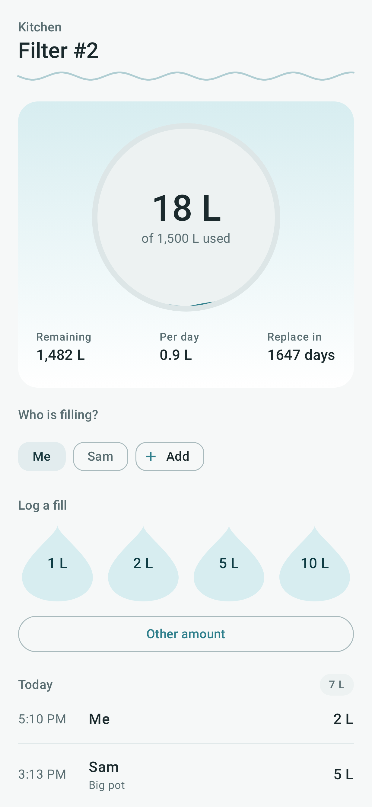
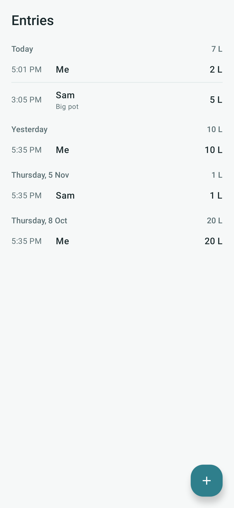
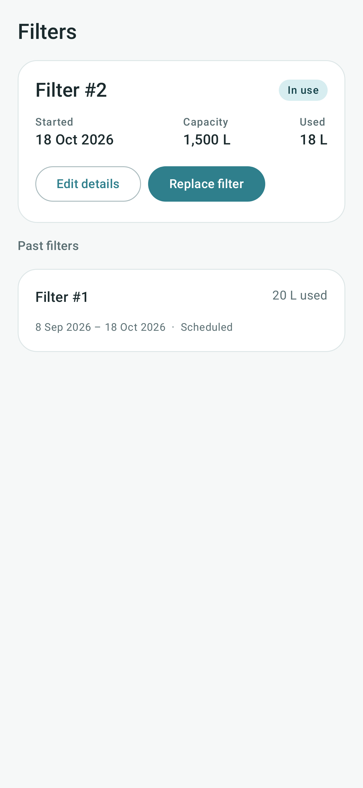
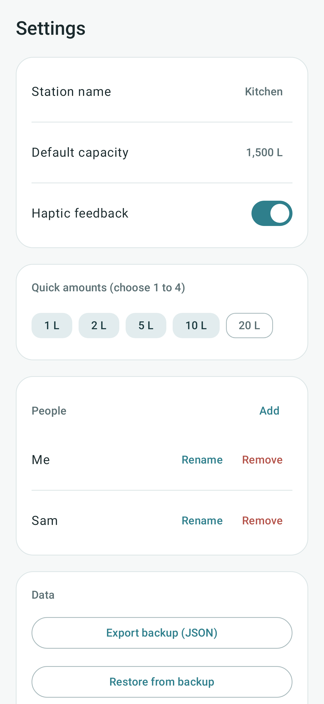
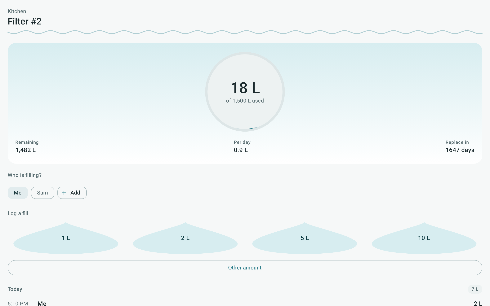

# FilterTap

Track water-filter use on this device. Log each fill, see how much of the filter's
capacity is used, and replace the filter when it's due.

- Kotlin, Jetpack Compose (Material 3), Room, DataStore
- minSdk 26. All data stays on the device.
- Backups use the same JSON layout as the web version, so a web backup can be restored here.

## Screenshots

| Tracker | Entries | Filters | Settings |
|---|---|---|---|
|  |  |  |  |

Tablet layout: 

Screenshots are rendered from the real screens by the **Screenshots** workflow (`./gradlew recordRoborazziDebug`).

## Responsive layout

- Phones (under 840 dp wide): bottom navigation bar.
- Tablets and desktop windows (840 dp and wider): navigation rail on the left.
- Content is capped at 720 dp and centred, so lines never stretch across a wide screen.

## Build

Open in Android Studio, or run `./gradlew assembleDebug`.

## Release

The **Release APK** workflow is manual only (`workflow_dispatch`). It needs three
Actions secrets: `KEYSTORE_BASE64`, `KEYSTORE_PASSWORD`, `KEY_PASSWORD`.
The keystore alias is `filtertap-release-key`. Keep the keystore out of the repo.
